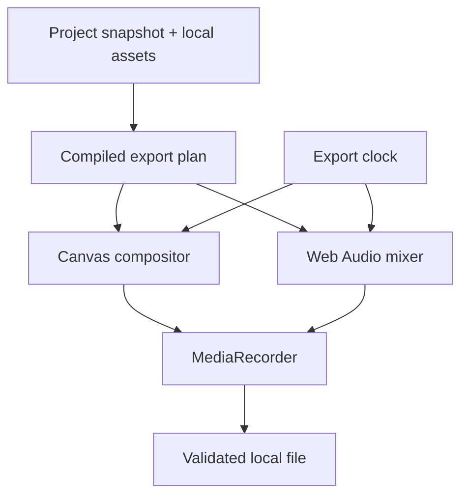

# QARTON Motion Studio — L10-A · Integrated Audio & Video Export

الحالة: تصميم للمراجعة. خط الأساس `5e34e9be768ef9367665c4ebd3a07809f9004002`، رأس PR #122، مع عقود الصوت من #120 والمؤثرات من #121. قرارات الجودة وحدود القياس أدناه أهداف قبول أولية تخضع لتجربة Android.

## 1. تدقيق خط الأساس

| المسار | سلوك النسخة المراجعة | قرار L10-B |
|---|---|---|
| `examples/motion-studio-lab/studio.js` | `exportVideoFile` يرسم على Canvas منفصل ويستخدم `captureStream(fps)` وMediaRecorder. الصوت الاختياري نبضات اختبار. `renderExportFrame` يأخذ عينات الكاميرا والشخصية وVisemes والمؤثرات، لكنه يقرأ عدد مفاتيح الشخصية من حالة المحرر. | تجميد المدخلات عند القفل، وتوفير compositor مشترك بمعاملات صريحة. إبقاء النبضات في مختبر التحقق. |
| `studio-export-core.js` و`../motion-studio-export-lab/export-lab-core.js` | مساعدات MIME والرسم للحجم المطلوب والقفل وحد 24 MiB. `projectTimeAt` يمدد أو يضغط زمن المشروع لاختيارات مدة التسجيل. توقيت النتيجة يقاس حول recorder، وذيل النهاية ثابت 100ms. | إعادة استعمال الصالح من المساعدات. المسار المدمج يستعمل القص بزمن 1×، ويقيس المدة من الملف أو يصرّح بأنها مجهولة. إبقاء API القديم واختباراته. |
| `studio-audio-model.js` و`src/audio/cinematic-audio-core.js` | compiler يوفّر clips مطبّعة وVisemes يدوية بالعربية والتونسية. نافذة المقطع نصف مفتوحة، وloop للموسيقى فقط. المعاينة تستعمل HTMLAudio وScene Clock بمصدر performance.now؛ JSON يحفظ المراجع وبيانات المسارات، والملفات تحتاج إعادة ربط. | إعادة استعمال compiler والعينات؛ جدولة Web Audio مستقلة خاصة بالتصدير. |
| `src/motion/scene-clock.js` و`packages/motion-studio/index.js` | ساعة نقل بمصدر قابل للحقن؛ `compileProject/sampleFrame/drawFrame` تنفّذ أخذ عينات مطلقة. حد core للمشروع 300s، ومحرر المختبر 3–60s. | إبقاء نقل المعاينة مستقلًا. إدخال زمن مطلق واحد إلى compositor وتوثيق حدود المحرر منفصلة عن حدود التصدير. |
| `studio-visual-effects-model.js` و`src/effects/cinematic-effects.js` | عينات المؤثرات والكاميرا مرتبطة بزمن المشهد؛ أولوية L9-B واستمرار قيم النهاية وShake المعتمد على أبعاد raster. | استعمال نفس أدوات أخذ العينات لكل raster؛ تطبيق Shake وتحويل الكاميرا مرة واحدة، ثم overlays بعد الشخصية. |

## 2. الهندسة وعقود الاستعمال



مدخلات المضيف تكون adapters محلية، واستيراد الحزمة آمن في Node دون قراءة globals عند تحميلها. لا حاجة للميكروفون أو الإنترنت. العقود المقترحة داخل `@qarton/cinematic-engine/motion-studio`:

```ts
probeExport(options): Promise<ExportCapability[]>
planExport(snapshot, request, capabilities): ExportPlan
startExport(plan, host, { signal, onProgress }): Promise<ExportResult>
```

- `snapshot` يشمل المشروع والمسارات المجمّدة، master gain ومعرّفات الأصول وإصداراتها. `host` يملك `resolveAudio(assetId, signal): Promise<Blob|null>` وموارد الصور للقراءة فقط و`renderFrame(ctx, sceneMs, viewport, frameContext): void`. الموارد المقترضة تبقى ملك المضيف.
- `request` يشمل `range: {startMs,endMs}` افتراضيًا كامل المشروع، `quality: '480p'|'720p'|'1080p'`، fps، `format: 'auto'|'mp4'|'webm'`، `audio: 'mix'|'none'` و`missingAudio: 'error'|'silence'` افتراضيًا error. المدة = end − start، مع تحقق صحيح ومحدود داخل المشروع. اختيار 3s/10s للمسار المدمج يعني نافذة من المشهد، مع تسمية واضحة للمستخدم.
- `ExportCapability` يسجل MIME والـraster وfps ووضع الصوت وحالة advertised/verified/failed. `ExportPlan` ثابت، يضم الحدود الزمنية، raster، ميزانيات البايت والـPCM، المرشحين، والمقاطع الواقعة داخل النافذة.
- `onProgress` يقدّم phase وelapsedMs وtargetMs وrenderedFrames وdroppedFrames. `ExportResult` يقدّم Blob وMIME الفعلي والامتداد والأبعاد والمدة المستهدفة و`measuredDurationMs: number|null` وتحذيرات وعدادات التوقيت. UI يملك Object URL. عملية واحدة لكل مضيف؛ AbortSignal يفيد التحضير والتسجيل والتحقق. الأخطاء typed: ASSET_MISSING، DECODE_FAILED، UNSUPPORTED_FORMAT، CAPTURE_FAILED، BACKGROUNDED، CLOCK_STALLED، BUDGET_EXCEEDED، INVALID_OUTPUT وAbortError.
- اعتماد `StudioProjectV1` وJSON الحاليين، مع مسارات غائبة = فارغة وmaster = 1. الخيارات خاصة بالجلسة. الفصل بين إعدادات الصوت للتصدير ومعاينة المحرر يحفظ سلوك Play/Seek/Replay والألعاب القائمة. واجهة المحرر تبدأ من موضعها نفسه بعد الجلسة في وضع الإيقاف المؤقت.

## 3. مزج الصوت

رسم Web Audio: AudioBufferSource لكل مقطع → Gain للمقطع → Gain للمسار → master → headroom/حماية clipping → MediaStreamAudioDestinationNode. وصلة recorder تحصل على audio track واحد. إخراج السماعات غير متصل؛ إيقاف المعاينة قبل البدء. استكشاف وضع audio:none بالفيديو وحده، وmix يسمح بمسار صامت عند غياب مقاطع قابلة للتشغيل.

- استخرج تقاطع `[clip.start, clip.end)` مع نافذة التصدير. وقت بداية المصدر = epoch + (بداية التقاطع − بداية النافذة)/1000. offset المصدر = بداية التقاطع − بداية المقطع. يتوقف عند نهاية التقاطع أو نهاية الملف إن كان one-shot. للموسيقى المكررة loop على طول الملف مع `offset % bufferDuration`، ويتوقف عند نهاية الحد الزمني. الفجوات صفر. المقاطع المتداخلة تُجمع، بما فيها مقاطع المسار نفسه. ناتج كل مقطع يتناسب مع clip × track × master، وvolume صفر صمت دون تغيير التوقيت.
- L10-B يستعمل headroom ثابتًا لكل جلسة، محسوبًا من ذروة مجموع المكاسب المتزامنة (وافتراض ذروة مصدر 1 بعد ضبط القنوات إلى stereo) مع هامش dB موثق. لا تطبّع كل مقطع وحده. اختبار جمع المصادر وحدود الذروة والانتقالات. ramps قصيرة عند قص حدود غير صفرية، محصورة داخل نافذة المقطع، مع اختبار المقاطع القصيرة.
- فك ترميز كل asset فريد محليًا مرة واحدة، بتتابع وبذاكرة مقاسة من `length × channels × 4`، مع ميزانية للأصول المضغوطة والمنسوخة أثناء decode. الجلسة تتوقف عند تجاوز الميزانية. إن عاد decode بعد الإلغاء، تُسقط نتيجته. 60s stereo PCM/48kHz ≈22 MiB حتى قبل buffers الأخرى؛ خمسة دقائق ≈110 MiB لمصدر واحد.
- preflight يبلغ كل المراجع المفقودة الواقعة في النافذة بالمسارات والمقاطع. خيار silence يحتاج اختيارًا صريحًا ويبلّغ المتروك؛ فشل decode للمصدر الموجود يُشخّص منفصلًا. على التصدير المدمج تستمر Visemes للمقاطع الموجودة عند gain صفر للمحافظة على الأداء المؤلف؛ عند مصدر مفقود مسكوت عنه أو نفاد ملف حوار one-shot تُستبعد مساهمته من عينة الحوار، ويعود الفم إلى pose الشخصية أو المساهمين الآخرين. وضع الفيديو فقط يحافظ على Visemes المؤلفة. تداخل حوارات الشخصية الواحدة يحافظ على قاعدة أكبر mouthOpen في L9-B. لا توليد تلقائي للشفاه.

## 4. ساعة التسجيل، الإطارات، دورة الحياة

1. قفل التعديل، إيقاف المعاينة، أخذ snapshot. أنشئ أو استأنف AudioContext من ضغطة المستخدم قبل await طويل، وتحقق من running بعد التحضير. افحص الأصول والميزانيات وvisibility، وارسم frame عند بداية النافذة. جهّز track الفيديو والمسار المختلط قبل start. استخدم `captureStream(0)` + requestFrame إن نجح الاختبار الفعلي، وإلا `captureStream(fps)` على stream جديد.
2. بعد جاهزية جميع العقد اربط `start/dataavailable/error/stop` وwatchdog. بدء MediaRecorder قبل تفعيل محتوى الصوت يحد من ضياع أول مقطع. على حدث start، اختر epoch مشتركًا قريبًا في AudioContext.currentTime (lead أولي 30–50ms قابل للقياس)، جدْول الصوت، واثبت على frame البداية خلال lead. سجّل الفارق بين طلب start والحدث وزمن epoch كتليمترية محلية. عند الفيديو وحده استعمل performance.now. استخدم المصدر المختار لجميع العينات بعد epoch. لا تستعمل عدد chunks أو RAF كساعة، ولا تستعمل زمن سماعات getOutputTimestamp كمرجع mux.
3. عند كل RAF احسب elapsed من epoch، واختر أحدث index مستحق. ارسم عند timestamp الإطار الاسمي المطابق. تخطّ الإطارات المتأخرة وسجّلها؛ لا ترسم backlog ولا تبطّئ الصوت. عيّن الزمن نفسه للخلفية والكاميرا والشخصية والشفاه والمؤثرات في framebuffer واحد، مع تحويل raster مرة واحدة. requestFrame يطلب الالتقاط ولا يعطي PTS صريحًا؛ معدل الإطارات الفعلي يُقاس. عند تقطع متواصل (250ms فجوة أو أكثر من 10% إطارات فائتة في نافذة 2s بعد الإحماء، قيم أولية) أوقف بهدوء واعرض إعادة المحاولة بجودة أقل.
4. نهاية الصوت تُجدول عند epoch + range. عند بلوغها ارسم النهاية مرة واحدة واطلب الالتقاط ثم اطلب stop بعد فرصة رسم محدودة بإطار واحد تقريبًا، مع مؤقت حماية. انتظر final dataavailable ثم stop بمهلة؛ لا تعرض ملفًا فارغًا أو جزئيًا. lead وtail قد يظهران في الحاوية؛ قياسهما من وسوم الاختبار، مع حد قبول أدناه. عند تجاوز الحد، يسقط دعم ذلك profile أو يلزم backend بطوابع زمنية وmux لاحقًا؛ MediaRecorder وحده لا يتيح تعهدًا بدقة عينة أو frame.
5. حالات العملية: preparing → recording → finalizing → validating → completed، والفشل/الإلغاء من أي مرحلة قبل الاكتمال. visibilitychange إلى hidden أثناء العمل، pagehide، تعليق سياق الصوت أو انتهاء track غير المتوقع يوقفون الجلسة بسبب واضح. لا استئناف لملف متقطع. watchdog مستقل عن RAF يكشف انقطاع تقدم الساعة حين يسمح المتصفح بتنفيذه. Wake Lock اختياري إن توفر؛ عمليًا يلزم إبقاء الصفحة مفتوحة والشاشة شغالة، ولا ضمان لاستقبال event عند قتل التطبيق.
6. cleanup واحد idempotent يوقف timers/RAF/listeners والسجلات، ويوقف جميع tracks والعقد، يفصلها ويغلق AudioContext المملوك ويحرر مرجع PCM/chunks وCanvas وwake lock. في النجاح تُوقف tracks بعد آخر بيانات؛ في الإلغاء يُهمل الناتج حتى إن وصل stop متأخرًا. تحقق من هوية الجلسة قبل تعديل UI، وأطلق القفل في finally. ألغِ Object URLs المؤقتة عند الاستبدال/المغادرة، واحتفظ برابط النتيجة فقط ما دامت ظاهرة. فك اشتراك المستمعين من الموارد المشتركة دون إغلاقها.

## 5. Android والصيغ والسعة

- اختبر وجود APIs ورسم Canvas origin-clean، واستخدم `isTypeSupported` كترشيح أولي. جرّب MP4/H.264 + AAC وWebM/VP8 + Opus ثم VP9 عند ثبوت الأداء؛ مرشحا container الخام يحتاجان نفس التحقق الفعلي. probe صغير محلي (~1s، صورة متغيرة ونبضة) يتحقق من start وchunks وإمكان فك الفيديو ووجود الصوت في وضع mix. أعد اختبار profile على raster/fps المطلوب، لأن probe الصغير لا يثبت قدرة الترميز الحرارية أو الذاكرة. اربط النتائج بـ MIME/raster/fps/audio mode في الجلسة.
- auto يميل إلى MP4 المتحقق لسهولة المشاركة، ويفضّل WebM إن فشل، أو كان أثبت ضمن ميزانية الجهاز. يجوز تجربة المرشح التالي قبل بدء محتوى المشروع فقط مع stream نظيف. اختيار MP4 أو WebM الصريح لا يغيّر الحاوية دون موافقة. اعتمد MIME المبلغ به فعليًا وبيانات الحاوية عند الإمكان؛ عند تعارض النوع أو فساد الملف، أبلغ خطأ. بعض WebM يعطي duration غير محدودة أو seek ضعيفًا؛ تحقق محليًا من metadata والبحث قرب النهاية. إذا لزم إصلاح metadata فليكن remux محليًا محدود الموارد، مع اختبار مستقل؛ لا تستخدم مدة wall clock بوصفها مدة الملف.
- ميزانية أولية: سقف ناتج in-memory الحالي 24 MiB، PCM 32 MiB، وتحضير الصور ضمن ميزانية منفصلة. preflight يتوقع `durationSec × (videoBps + audioBps)/8` + هامش أولي 20%؛ افحص الحجم التراكمي أثناء التسجيل. chunks وسيلة تدفق وليست سقفًا مضمونًا لذاكرة المتصفح. لا تعتمد على deviceMemory أو على latency لحظية لإثبات الأهلية. Canvas RGBA واحد بحجم 1080×1920 ≈7.9 MiB قبل نسخ GPU/encoder والصور.
- حافظ على النسبة والأبعاد الزوجية حيث يتطلب المشفّر، واقصر على حدود الصندوق landscape/portrait مع تجنب رفع دقة المصدر افتراضيًا. قيم الاختبار الأولى:

| Profile | Raster مرجعي عمودي | معدل مستهدف | استعمال مقترح |
|---|---|---|---|
| 480p | 480×854 | 24 fps، 1 Mbps + 96 kbps | إعادة محاولة خفيفة، وحتى 60s ضمن الميزانية |
| 720p | 720×1280 | 24 fps، 2.5 Mbps + 128 kbps | الافتراضي بعد probe ناجح، ابدأ بـ3–10s ثم اختبر 30/60s |
| 1080p | 1080×1920 | 24 fps، 5 Mbps + 128 kbps | اختياري، 3–10s بعد probe بنفس الدقة ونجاح جهاز حقيقي |

- عند 30–60s قرّر الجودة من preflight والجهاز؛ مثلًا 60s على 720p يتجاوز 24 MiB مع هامش 20% وفق هذه القيم. للمدد الأطول جهّز API range داخل حد 300s للـcore، مع إبقاء محرر L10-B عند 60s. إذا تجاوز مشروع الميزانية يستطيع المستخدم استخراج ranges مستقلة. ضم MP4/WebM مستقلة بالـBlob concatenation غير مضمون. ملف طويل واحد لاحقًا يحتاج sink محليًا إلى القرص عند توفره، أو WebCodecs ومجمّع timestamps ومخرجات محلية بعد تقييم دعم Android و`file://`. لا يدخل في قبول L10-B.
- قيود Chrome Android وWebView تشمل تعطيل RAF في الخلفية، codec مختلف، تعليق الصوت بسبب إدارة الطاقة، واستهلاك GPU غير مرئي من JS. MediaRecorder، Canvas والتخزين المحلي للحزمة تبقى المسار الأول؛ لا ضمان MP4 أو 1080p قبل اختبار الجهاز وإصدار WebView المحددين.

## 6. تسليم لونا — L10-B

ابدأ فرع تنفيذ مستقلًا من تصميم L10-A المقبول. اقترح ترتيب commits التالي:

| الترتيب | الملفات | شرط الانتقال |
|---|---|---|
| 1 | الجديد `packages/motion-studio/export/export-plan.js` و`tests/motion-studio-export-plan.test.js` | snapshot/range/profile/MIME selection والميزانيات واختبارات حدود قديمة وجديدة. |
| 2 | الجديد `packages/motion-studio/export/audio-mix.js` و`tests/motion-studio-export-audio.test.js` | fixture محلي PCM، تقاطع وoffset وloop والتداخل والمكاسب والصمت، وتحضير قابل للإلغاء. |
| 3 | الجديد `packages/motion-studio/export/recording-session.js` و`packages/motion-studio/export/index.js`، وربط `packages/motion-studio/index.js` | probe ومسار التسجيل بساعة موحدة، cleanup واختبارات fake recorder للترتيب والإلغاء والمهل وfallback. استخرج primitive مشترك من L5 فقط إذا بقيت الاختبارات القديمة ناجحة. |
| 4 | `examples/motion-studio-lab/{studio.js,index.html,README.md}` ووحدة مشهد مشتركة مقترحة `studio-scene-renderer.js` | تجميد الحالة وقفل التحرير، رسم مطابق للمعاينة، خيار صوت المشروع وحفظ النتيجة، تحذيرات وإلغاء. تشغيل المعاينة بعد العودة بقرار المستخدم. |
| 5 | `scripts/check-motion-studio-preview.py` و`scripts/build-motion-studio-preview.mjs` و`.github/workflows/motion-studio-preview.yml` | ZIP ذاتي offline، Chromium فعلي، artifact واضح L10-B. شغّل Node والـworkflows المرتبطة. وثّق تقرير الجهاز والمصفوفة. |

### اختبارات القبول

- Node: خطة الزمن بزمن ثابت، مستهل عند t=0، قص clip من وسطه، حد نهاية نصف مفتوح، loop مع offset، صمت، مخلوط gains وheadroom، ملفات ناقصة/تالفة، أصول مشتركة، Abort قبل start وأثناء decode/record/finalize، خطأ encoder وstop قبل اكتمال البيانات وتجاوز الحجم. اختبر re-export بعد كل حالة. شغّل جميع الاختبارات السابقة و3s/10s L5، مع عينات Shake وتأثيرات متداخلة وعند السعي وإعادة التشغيل.
- Chromium حقيقي: fixture محلي بومضة نابضة والنبض الصوتي على توقيت معروف، مع حدث كاميرا وViseme ومؤثر في نفس التوقيت. فك الناتج بالـbrowser وعند الحاجة ffprobe/ffmpeg في CI فقط. تحقق من الحاوية والمسارات والأبعاد وقابلية التشغيل والانتقال قرب النهاية. عيّن PTS للفيديو وأول عينات النبضة وافحص مواضع في البداية والوسط والنهاية (3/10/30/60s حيث ينطبق). لا يقاس A/V بمواعيد أحداث DOM وحدها.
- حدود قبول أولية عند 24fps: |فرق الصوت والفيديو| ≤100ms عند كل علامة، تغير الفرق بين أول وآخر علامة ≤50ms، وخطأ مدة الملف ≤ max(150ms، فترتي إطار). تحقق من وجود نبضة البدء حتى مع lead، وعدم بتر نبضة قرب النهاية. تمر حالة تأخر إطار واحدة دون انزياح مستمر؛ التأخر الشديد يؤدي لفشل مفسر. تحقّق أيضًا من video-only وصوت صامت وfallback وتحرير UI/الموارد بعد hidden.
- مصفوفة فعلية Android: HONOR 400 Pro/Chrome، جهاز RAM منخفض إن توفر، وAndroid System WebView لمضيف QARTON عند توفره. سجّل الإصدار، نوع الحاوية الفعلي، الزمن، الأبعاد، drops، حجم الملف وPCM، وإمكانية التشغيل من مدير الملفات مع وضع الطائرة. افحص شاشة مقفلة وتبديل تطبيق وإلغاء واستعادة قابلية التصدير. كرّر 5 جلسات نجاح/إلغاء عند 720p وقياس heap/ذاكرة العملية إن أتاح الجهاز؛ لا نمو متواصل ولا tracks/contexts/URLs يملكها التصدير بعد التنظيف، ولا تخطٍّ للسقوف. شغّل 1080p كاختبار أهلية منفصل. دعم غير مثبت يُسجّل غير متحقق.
- لا تغييرات في الألعاب أو شكل JSON. لا ترقية وضع L10-B إلى جاهز للنشر عن طريق CI وحده؛ قياسات Android أعلاه منفصلة عن اختبارات المتصفح المؤتمتة.

## مراجع المنصة

- [MediaRecorder MIME support](https://developer.mozilla.org/en-US/docs/Web/API/MediaRecorder/isTypeSupported_static) و[Data availability and final chunks](https://developer.mozilla.org/en-US/docs/Web/API/MediaRecorder/dataavailable_event)
- [Canvas captureStream](https://developer.mozilla.org/en-US/docs/Web/API/HTMLCanvasElement/captureStream) و[requestFrame](https://developer.mozilla.org/en-US/docs/Web/API/CanvasCaptureMediaStreamTrack/requestFrame)
- [Web Audio stream destination](https://developer.mozilla.org/en-US/docs/Web/API/MediaStreamAudioDestinationNode) و[Audio buffer scheduling](https://developer.mozilla.org/en-US/docs/Web/API/AudioBufferSourceNode/start)
- [Page Visibility](https://developer.mozilla.org/en-US/docs/Web/API/Page_Visibility_API)
